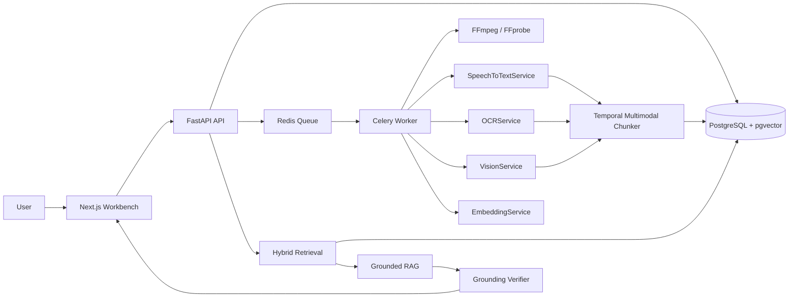

# Architecture

## Data Flow

1. Uploads and YouTube URLs create `videos` rows in `pending` or `downloading`.
2. The API enqueues a background job.
3. The worker extracts audio, timestamped speech, representative frames, OCR text, and visual descriptions.
4. Transcript, visual, and OCR signals are joined into timestamped `video_chunks`.
5. Each chunk gets an embedding and remains tied to `video_id`, `start_time`, and `end_time`.
6. Search combines hashing-vector similarity and keyword overlap. The interface supports replacing this with pgvector SQL and full-text search in production.
7. Ask retrieves only top evidence chunks, generates an extractive answer, verifies grounding, and refuses unsupported questions.

## Grounding Contract

The answer layer never receives the full corpus or external knowledge. It receives only the user question and retrieved video chunks. If evidence is weak or the verifier cannot match the generated answer back to supplied chunks, the API returns:

`I couldn't find this information in the provided videos.`

